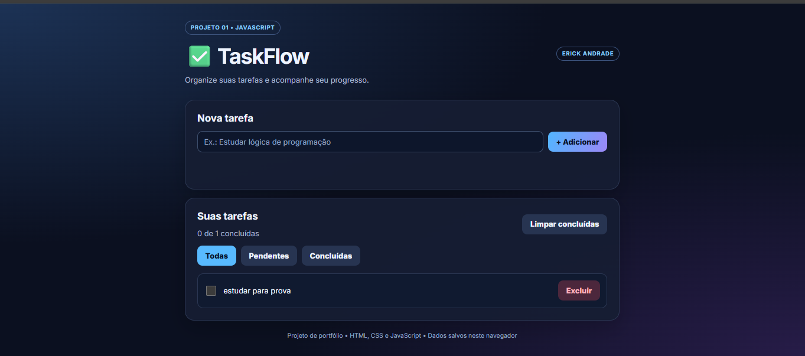

# ✅ TaskFlow — Gerenciador de Tarefas
## 📸 Visualização do Projeto

## 🚀 Experimente o TaskFlow

Clique no botão acima para acessar o aplicativo.

### 🚀 Organize suas tarefas, acompanhe seu progresso e aumente sua produtividade!

---

## 📌 Sobre o Projeto

O **TaskFlow** é uma aplicação web desenvolvida para facilitar a organização de tarefas do dia a dia, proporcionando uma experiência simples, intuitiva e funcional.

O projeto faz parte do meu portfólio de estudos em **Análise e Desenvolvimento de Sistemas**, com foco no desenvolvimento de habilidades práticas em programação e na aplicação de conceitos fundamentais de desenvolvimento web.

Durante o desenvolvimento e estudo deste projeto, são explorados conceitos como:

- Estruturação de páginas com HTML5.
- Estilização e responsividade com CSS3.
- Manipulação do DOM com JavaScript.
- Tratamento de eventos e interações do usuário.
- Armazenamento local de informações com `localStorage`.
- Organização e manutenção de código.

---

## ⚙️ Funcionalidades

O TaskFlow foi projetado para oferecer recursos essenciais
